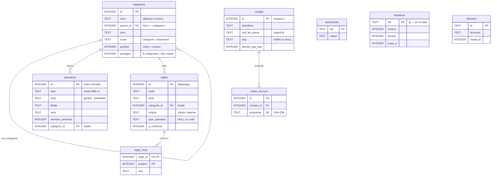

# Mes Comptes — documentation technique

Architecture, formats de données, API et choix d'implémentation. Pour le comportement vu de l'utilisateur, voir
[FONCTIONNEL.md](FONCTIONNEL.md). Le cahier des charges d'origine est [`PROMPT.md`](../PROMPT.md) ; les écarts sont
listés à la fin de ce document.

## Architecture

```
navigateur ──► php -S localhost:8000 router.php
                 ├── /api/*  → api/index.php (routeur, JSON)
                 │              └── api/src/ (classes Banque\) ──► base/banque.sqlite (SQLite)
                 │                                                └──► log/connexions.log
                 └── reste   → front/dist/ (application React construite, repli sur index.html)

développement : Vite (:5173) sert front/src et relaie /api vers :8000

en ligne : navigateur ──HTTPS──► Caddy ──► front/dist/ (fichiers statiques)
                                     └──► /api/* → PHP-FPM → api/index.php ──► base/, log/
```

- **Back** : PHP 8.5+ (extensions `mbstring`, `sodium`, `pdo_sqlite`), sans framework ni dépendance Composer. `declare(strict_types=1)`, PSR-12, types sur toutes les
  signatures. Chargement automatique des classes par `api/bootstrap.php`.
- **Front** : React 18, TypeScript strict, React Router 7, Recharts, Vite 8. Polices embarquées via `@fontsource`
  (aucune requête externe).
- **Stockage** : base **SQLite** `base/banque.sqlite` (requêtes préparées, clés étrangères, index) ; seuls les
  journaux restent des fichiers, dans `log/`. `base/`, `log/`, l'ancien `data/` et `csv/` sont ignorés par git.
- **Montants** : toujours en **centimes entiers** dans les calculs (PHP et TypeScript), jamais en flottants.

### Classes PHP (`api/src/`)

| Classe | Rôle |
|---|---|
| `Router` | Associe méthode + motif d'URL (`{nom:regex}`) à un gestionnaire ; 404 / 405 |
| `RequestGuard` | Avant toute route : hôte autorisé (DNS rebinding), même origine pour les écritures (CSRF), corps en `application/json` |
| `HttpException`, `CsvFormatException`, `LineConflictException` | Erreurs → statut HTTP (voir « Erreurs ») |
| `Database` | Connexion PDO SQLite (réglages), transactions immédiates, migrations du schéma, sauvegardes `VACUUM INTO`, `Database::open` |
| `Paths` | Emplacements : base, sauvegardes, archives, journaux, ancien `data/` |
| `CsvParser` → `ParseResult`, `ParsedLine`, `RejectedLine` | Lecture du CSV Crédit Agricole |
| `Amount` | Texte ↔ centimes (`"2 640,31"` → 264031 → `"2640,31"`) |
| `Text` | Espaces, majuscules sans accents |
| `LabelNormalizer` → `NormalizedLabel` | Type d'opération et détail nettoyé d'un libellé |
| `Rule`, `RuleRepository` | Une règle (correspondance, priorité, forme JSON de l'API) ; tables `regles` et `regle_mots` |
| `Categorizer` → `Categorization` | Moteur de règles et repli par type d'opération |
| `CategoryCatalog` | Catégories existantes (validation) |
| `CategoryRepository` | Table `categories` : arbre, recherche d'une feuille par chemin, ajout, renommage, suppression |
| `CategoryManager` | Ajout, icône, renommage et suppression avec remplacement (validation, messages) |
| `SettingsRepository` | Table `parametres` |
| `DefaultData` | Catégories, règles et paramètres initiaux, installés dans une base neuve (`seed`) ; liste des thèmes |
| `Direction` | Énumération `dépense` / `revenu` |
| `MonthLine` | Forme JSON d'une ligne (API), clé de doublon, validation d'une ligne reçue |
| `OperationRepository` | Table `operations` : mois, lignes d'un mois ou d'une année, « À trier », ajout, recatégorisation par identifiants |
| `Importer` | Aperçu et confirmation d'un import, fusion par occurrences |
| `Account` | Le compte unique (tables `compte`, `codes_secours`) : création, mot de passe Argon2id, code TOTP ou de secours |
| `Totp` | Codes TOTP (RFC 6238), base32, adresse `otpauth://` pour le QR code |
| `SecretBox` | Chiffrement du secret TOTP avec libsodium ; clé lue dans `BANQUE_CLE` ou `BANQUE_CLE_FICHIER` |
| `LoginThrottle` | Limitation des tentatives de connexion (table `tentatives`) |
| `AuthConfig` | Poste local ou non, double authentification exigée ou non (`BANQUE_TOTP`) |
| `EnvFile` | Lecture de `.env.local` par `router.php` (poste local uniquement) |
| `Auth` | Connexion en deux temps, expiration de session, jeton CSRF, contrôle avant chaque route protégée |
| `SessionStore`, `PhpSession` | Données de session ; sessions PHP natives durcies (cookie, mode strict) |
| `DatabaseSessionHandler` | Stockage des sessions PHP dans la table `sessions` |
| `AuditLog` | Journal des connexions (`log/connexions.log`) |
| `LegacyJsonMigration` | Migration de l'ancien `data/` (JSON) vers la base : lecture, import, comparaison, archive, nettoyage |

### Front (`front/src/`)

| Fichier | Rôle |
|---|---|
| `types.ts` | Types partagés : réponses de l'API (lignes et règles avec leur `id`) |
| `api.ts` | Client HTTP ; ajoute `X-CSRF-Token` aux écritures ; émet `mes-comptes:donnees` après chaque écriture (badge « À trier ») et `mes-comptes:session` sur un 401 hors connexion (session expirée) |
| `auth.ts` | État de session, jeton CSRF gardé en mémoire (jamais dans `localStorage`), écran à afficher (testés) |
| `aggregate.ts` | Totaux, regroupements par catégorie, matrice annuelle, ordre chronologique (testés) |
| `importLogic.ts` | Ordre d'affichage et contenu envoyé à la confirmation d'import (testés) |
| `format.ts` | Centimes ↔ texte, format français `1 234,56 €` (testés) |
| `categories.ts`, `colors.ts`, `months.ts`, `operationTypes.ts`, `theme.ts` | Aides d'affichage |
| `useRecategorisation.tsx` | Recatégorisation + fenêtre d'apprentissage, partagée par Mois, Année et À trier |
| `pages/` | Une page par onglet, plus `LoginPage` (connexion en deux temps) |
| `components/` | Blocs de graphiques, tableaux, matrice, fenêtres, sélecteurs de catégorie |
| `styles.css` | Styles ; les trois chartes sont des jeux de variables CSS sur `[data-theme]` |
| `public/theme-init.js` | Applique la dernière charte avant le premier affichage ; fichier séparé car la CSP interdit les scripts en ligne |

`App.tsx` appelle `GET /api/session` au démarrage et à chaque événement `mes-comptes:session` : tant que l'étape
n'est pas `connecte`, seule `LoginPage` est affichée et aucune autre route n'est appelée. L'URL est conservée : après
une reconnexion, on retrouve la page où l'on était.

## Base de données (`base/banque.sqlite`)

SQLite 3.37+ (tables `STRICT`). Schéma : `api/schema/001_initial.sql` ; version dans `PRAGMA user_version`.

### Schéma relationnel



### Tables

| Table | Contenu | Points importants |
|---|---|---|
| `categories` | Arbre à deux niveaux | Dépense : catégorie 1 (avec icône) et sous-catégories (`parent_id`). Revenu : un seul niveau. `position` donne l'ordre, donc la couleur dans les graphiques (position modulo 12 dans la palette de la charte). Noms uniques par niveau (index partiels). `protegee` : « À catégoriser » et « Non classé » |
| `operations` | Une ligne de relevé | `date` ISO, `mois` colonne générée (`AAAAMM`), montant en **centimes entiers**, `categorie_id` = feuille (sous-catégorie pour une dépense, catégorie 1 pour un revenu). Ordre : `date`, puis `id` (ordre d'arrivée) |
| `regles` + `regle_mots` | Règles de catégorisation | Voir ci-dessous ; `regle_mots` : autres mots requis (condition ET), dans l'ordre |
| `parametres` | Clé → valeur | `thème` : `guimauve`, `sauge` ou `nuit`. Le front garde une copie dans `localStorage` (`mes-comptes-theme`) pour appliquer la charte avant le premier affichage ; la base reste la référence |
| `compte` | Le compte unique (`id = 1`) | Empreinte Argon2id du mot de passe (recalculée si les paramètres changent), secret TOTP chiffré par `SecretBox` ou `NULL` (poste local sans double authentification), `dernier_pas_totp` (un code ne sert qu'une fois) |
| `codes_secours` | Empreintes SHA-256 | 10 à la création ; un code utilisé est supprimé. Codes aléatoires (environ 50 bits) : un hachage lent n'est pas nécessaire |
| `tentatives` | Échecs de connexion | Par IP (`ip:<adresse>`) et pour le compte (`compte`) : 5 échecs → 15 min de verrouillage, puis le double à chaque série (au plus 24 h) ; oubliés après 24 h sans échec |
| `sessions` | Sessions PHP | Données sérialisées par PHP, expiration ; purgées par le ramasse-miettes de PHP |

**Contraintes** :
- clés étrangères actives :
  - `operations` et `regles` → `categories` en `RESTRICT` (impossible de supprimer une catégorie utilisée) ;
  - sous-catégories, `regle_mots` et `codes_secours` en `CASCADE` ;
- `CHECK` sur le sens, l'origine, le format de date, `montant_centimes >= 0`, `compte.id = 1` ;
- déclencheurs :
  - une opération ou une règle vise une feuille du même sens ;
  - une sous-catégorie n'existe que sous une catégorie 1 de dépense ;
  - la hiérarchie ne se modifie pas.

**Index** :
- `operations(mois, date, id)` : vues Mois et Année, doublons d'import ;
- `operations(categorie_id)` : « À trier », usage et remplacement d'une catégorie ;
- `regles(categorie_id)` ;
- `categories(parent_id, position)` ;
- `sessions(expire_le)`.

Les requêtes fréquentes sont vérifiées par `EXPLAIN QUERY PLAN` dans `SchemaTest`.

**Conséquences** :
- un renommage de catégorie ne modifie qu'une ligne de `categories` ;
- une suppression avec remplacement fait un `UPDATE … SET categorie_id`, puis le `DELETE` ;
- une page n'exécute que quelques requêtes, quel que soit le nombre de mois enregistrés.

### Règles

L'API rend une règle sous cette forme (`id` absent pour une règle pas encore enregistrée) :

```json
{ "id": 12, "motif": "PRET HABITAT", "type": "dépense", "catégorie1": "Banque & assurances",
  "catégorie2": "Assurance emprunteur", "et": ["ASSU"], "origine": "initiale" }
```

| Champ | Obligatoire | Description |
|---|---|---|
| `motif` | oui | Mots recherchés (mots entiers, insensible à la casse et aux accents) |
| `type` | oui | `dépense` ou `revenu` |
| `catégorie1` + `catégorie2` / `catégorie` | oui | Selon le sens |
| `origine` | oui | `initiale` ou `apprise` |
| `et` | non | Autres motifs, tous requis |
| `type_operation` | non | Code du type d'opération requis (voir ci-dessous) |
| `a_confirmer` | non | `true` : ligne mise en évidence à l'import |

Codes de type d'opération : `CARTE`, `PRELEVEMENT`, `VIREMENT_RECU`, `VIREMENT_EMIS`, `RETRAIT`, `REGLEMENT`,
`REMISE_CHEQUE`, `CHEQUE`, `FRAIS`, `COTISATION`, `INTERETS`, `REMBOURSEMENT_PRET`, `REJET`, `REGULARISATION`,
`AVOIR`, `AUTRE`.

Le texte comparé aux motifs est `type tel qu'écrit + détail nettoyé` (ex. `PAIEMENT PAR CARTE AUCHAN PEROLS`).
Priorité : apprise > initiale, puis longueur du motif (somme des longueurs de `motif` et `et`), puis identifiant (ordre
de création). Une règle apprise de mêmes conditions qu'une autre la remplace en gardant son identifiant.

### Connexion, transactions et migrations du schéma

- **Réglages de connexion** :
  - `foreign_keys = ON` ;
  - `journal_mode = WAL` : les lectures continuent pendant une écriture ;
  - `busy_timeout = 5000` ;
  - `synchronous = NORMAL` ;
  - `PRAGMA optimize` à la fermeture.
- **Transactions** : `Database::transaction` ouvre une transaction `BEGIN IMMEDIATE` ; les appels imbriqués
  rejoignent la transaction en cours. Elle couvre :
  - la confirmation d'import : lecture des doublons et ajout dans la même transaction ;
  - la vérification d'un code ;
  - les modifications de catégories et de règles.
- **`Database::open`** (API et scripts) :
  - crée `base/`, `base/sauvegardes/` et `log/` (0700) ;
  - applique les fichiers `api/schema/NNN_nom.sql` dont le numéro dépasse `user_version`, chacun dans une
    transaction, après une sauvegarde si la base contient déjà des données ;
  - installe `DefaultData` dans une base neuve (catégories, 47 règles initiales, thème). Modifier `DefaultData`
    n'a pas d'effet sur une base existante.
- **Garde-fou** : tant que l'ancien `data/categories.json` existe sans base, l'API répond **503** (« migration
  nécessaire ») au lieu de démarrer sur une base vide. Ce contrôle ne s'applique qu'à l'emplacement par défaut de la
  base : une base d'essai (`BANQUE_BASE`) ne dépend pas de `data/`.
- **Nouvelle évolution du schéma** : ajouter `api/schema/002_description.sql` ; il est appliqué au démarrage
  suivant.

### Sauvegardes (`base/sauvegardes/`)

Copies cohérentes de la base par `VACUUM INTO` (même pendant l'utilisation), nommées
`banque-AAAAMMJJ-HHMMSS-xxxx.sqlite`, 20 gardées. Une copie est faite :
- avant chaque migration du schéma ;
- avant la première modification de chaque journée ;
- sur demande : `php api/bin/base.php sauvegarder`.

Pour restaurer :
1. arrêter le serveur ;
2. copier la sauvegarde voulue à la place de `base/banque.sqlite` ;
3. supprimer `banque.sqlite-wal` et `banque.sqlite-shm` s'ils existent.

Les sauvegardes locales ne protègent pas contre la perte du serveur : prévoir des sauvegardes externes chiffrées
(voir `AUDIT_SECURITE.md`).

### Emplacements et droits

L'API et les scripts fixent `umask(0077)` : base, sauvegardes, archives et journaux sont en 0600 (dossiers en 0700).

### Variables d'environnement

| Variable | Rôle | Défaut |
|---|---|---|
| `BANQUE_BASE` | Fichier SQLite (instance d'essai, serveur) | `base/banque.sqlite` |
| `BANQUE_LOG` | Dossier des journaux | `log/` |
| `BANQUE_HOTES` | Noms d'hôte acceptés en plus de `localhost`, `127.0.0.1` et `[::1]` (le nom de domaine du site en ligne), séparés par des virgules | aucun |
| `BANQUE_CLE` | Clé de chiffrement du secret TOTP, en base64 (`php api/bin/cle.php`) | aucune |
| `BANQUE_CLE_FICHIER` | Fichier contenant cette clé, à préférer à `BANQUE_CLE` sur le serveur (`/etc/banque/cle`, 0400) | aucun |
| `BANQUE_TOTP` | `desactive` retire la double authentification, **uniquement sur le poste local** (voir « Authentification ») | `obligatoire` |

Sur le poste local, ces variables peuvent être écrites dans **`.env.local`** à la racine (modèle :
`.env.local.example`, fichier ignoré par git). Il est lu par `router.php` seulement (`EnvFile::load`), donc par
`php -S` et par le proxy Vite, jamais en ligne où Caddy appelle `api/index.php` directement. Format `NOM=valeur`,
commentaires `#`, guillemets facultatifs ; seules les variables `BANQUE_*` sont acceptées (sinon erreur 500 avec la
ligne en cause) ; une variable déjà définie dans le shell est prioritaire. Les scripts `api/bin/` ne le lisent pas.

## Migration depuis les fichiers JSON (`data/`)

Jusqu'à novembre 2026, les données étaient dans des fichiers JSON : `data/mois/AAAAMM.json`, `categories.json`,
`regles.json`, `parametres.json`, `compte.json`, `tentatives.json`, plus `sessions/` et `sauvegardes/`.
`php api/bin/migrer-json.php` les transfère en trois temps :

| Commande | Effet |
|---|---|
| `php api/bin/migrer-json.php` | **Simulation** : lit et valide tout, affiche le nombre de catégories, de règles et d'opérations, les totaux par mois, et les anomalies (catégorie inconnue, montant illisible, date hors du mois…) ; rien n'est écrit |
| `… --appliquer` | Refuse si la base existe. Crée la base, importe tout en **une transaction** (l'ordre des fichiers est conservé dans les identifiants), puis **compare** la base aux fichiers : catégories, règles, chaque ligne de chaque mois, paramètres, compte. Au moindre écart (ou si `integrity_check` / `foreign_key_check` échoue), la base est effacée et `data/` reste intact |
| `… --nettoyer` | Recompare, crée `base/archives/data-avant-migration-AAAAMMJJ-HHMMSS.tar.gz` (tout `data/`, relu pour vérification, 0600), demande « oui », puis supprime les fichiers migrés, déplace `journal/connexions.log` dans `log/` (avant les lignes déjà présentes) et supprime `data/`. Un fichier inconnu n'est jamais supprimé : il est signalé et `data/` est gardé |
| `… --nettoyer --malgre-differences` | Si le site a servi entre `--appliquer` et `--nettoyer`, la comparaison échoue : cette option continue quand même, l'archive étant toujours créée avant toute suppression |

Options : `--source=DOSSIER` (défaut `data/`) ; la base cible suit `BANQUE_BASE` et `BANQUE_LOG`. Les sessions ne
sont pas migrées : il faut se reconnecter une fois. Pour revenir aux fichiers, l'archive contient l'ancien `data/`
complet (`tar xzf …`).

## API

Toutes les réponses sont en JSON. Les erreurs ont la forme `{ "erreur": "message" }`.

| Méthode et route | Corps / paramètres | Réponse |
|---|---|---|
| `GET /api/session` ¹ | | `{ compte, totp, etape, csrf, identifiant }` : `etape` vaut `identifiants`, `code` ou `connecte` ; `csrf` et `identifiant` seulement une fois connecté |
| `POST /api/connexion` ¹ | `{ identifiant, mot_de_passe }` | le nouvel état, comme `GET /api/session` |
| `POST /api/connexion/code` ¹ | `{ code }` : code TOTP à 6 chiffres ou code de secours | le nouvel état (+ `codes_secours_restants` si un code de secours a servi) |
| `POST /api/deconnexion` ¹ | | `{ connecte: false }` |
| `GET /api/sante` | | `{ statut }` |
| `POST /api/import/preview` | multipart, champ `fichier` (2 Mo max) | aperçu : `résumé`, `mois[].lignes[]` (avec `doublon`, `à_revoir`, `marchand`, `type_operation`, `motif`), `erreurs[]` — **n'écrit rien** |
| `POST /api/import/confirm` | `{ lignes: [{ date, libelle, sens, montant, catégorie }] }` (20 000 max) | `{ ajoutées, mois: [{ mois, ajoutées, doublons }] }` |
| `GET /api/mois` | | `["202504", …]` |
| `GET /api/mois/{YYYYMM}` | | `{ mois, lignes: [{ id, date, libelle, catégorie, dépense \| revenu }], analyse: [{ type_operation, marchand }] }` |
| `PATCH /api/operations/{id}` | `{ catégorie, autres?: [id…] }` : recatégorise l'opération et, en une fois, les opérations `autres` (lignes similaires) | le mois de l'opération, à jour |
| `GET /api/annee/{YYYY}` | | `{ année, mois: [mois au format ci-dessus] }` |
| `GET /api/a-trier` | | `[{ mois, lignes, analyse }]` : les lignes « À catégoriser » de chaque mois |
| `GET /api/categories` | | `{ dépenses: [{ nom, icone, sous_catégories }], revenus: [{ nom, icone }] }`, dans l'ordre des positions |
| `PUT /api/categories` | `{ action, sens, chemin, nom?, icone?, sous_catégorie?, remplacement? }` | `{ catégories, modifiés: { lignes, règles } }` |
| `POST /api/categories/usage` | `{ sens, chemin }` | `{ lignes, règles }` |
| `GET /api/regles` | | les règles (avec `id`), par identifiant croissant |
| `POST /api/regles` | `{ règle, appliquer_aux_mois }` | `{ règle (avec id), remplacée, lignes_mises_à_jour }` |
| `POST /api/regles/correspondances` | `{ règle, lignes: [{ libelle, sens }] }` | `{ correspondances: [bool] }` |
| `POST /api/regles/tester` | `{ libelle, sens }` | `{ type_operation, marchand, texte, catégorie, source, règle (avec id) \| null }` |
| `PUT /api/regles/{id}` | `{ règle }` | la règle (même identifiant, origine conservée) |
| `DELETE /api/regles/{id}` | | `{ supprimée }` |
| `GET /api/parametres`, `PUT /api/parametres` | `{ thème }` | les paramètres |

¹ Seules routes accessibles sans être connecté. Toutes les autres exigent une session connectée (sinon **401**) et,
pour les écritures, l'en-tête `X-CSRF-Token` (sinon **403**).

`PUT /api/categories` — actions :

| `action` | Champs | Effet |
|---|---|---|
| `ajouter` | `chemin` `[c1]` + `icone` (+ `sous_catégorie` pour une dépense), ou `[c1, c2]` | Ajout |
| `icone` | `chemin` `[c1]`, `icone` | Changement d'icône |
| `renommer` | `chemin` `[c1]` ou `[c1, c2]`, `nom` | Renommage (une ligne de `categories` : opérations et règles suivent) |
| `supprimer` | `chemin`, `remplacement` (`[revenu]` ou `[c1, c2]`) si la catégorie est utilisée | Lignes et règles déplacées, puis suppression |

### Désignation par identifiant

Les opérations et les règles sont désignées par leur identifiant en base, stable : il ne change pas quand d'autres
lignes sont ajoutées, recatégorisées ou supprimées. Un identifiant qui n'existe plus donne **404** (« rechargez la
page »), sans rien écrire. La confirmation d'import ne dépend d'aucun identifiant : elle reçoit toutes les lignes du
CSV et refait la fusion dans une transaction, ce qui la rend rejouable sans doublon.

### Erreurs

| Statut | Cas |
|---|---|
| 400 | Corps JSON absent ou mal formé, fichier manquant, paramètre invalide |
| 401 | Pas connecté, session expirée, identifiants ou code faux |
| 403 | Hôte non autorisé, écriture venue d'une autre origine (`RequestGuard`), jeton CSRF absent ou faux, double authentification exigée mais non configurée |
| 404 | Route, mois, opération ou règle inconnus |
| 405 | Méthode non autorisée |
| 413 | Fichier (2 Mo) ou corps (10 Mo) trop volumineux |
| 415 | Corps JSON envoyé sans `Content-Type: application/json` |
| 422 | Données refusées : CSV sans en-tête, catégorie inconnue, montant invalide, règle mal formée… |
| 429 | Trop de tentatives de connexion (`reessayer_dans`, en secondes) |
| 503 | Migration nécessaire : l'ancien `data/` (JSON) n'a pas encore été transféré dans la base |
| 500 | Erreur interne : le client ne reçoit qu'une référence (`{ erreur, reference }`) ; le détail est dans le journal d'erreurs de PHP, préfixé `[banque <référence>]` |

## Authentification

Un seul compte (tables `compte` et `codes_secours`), créé en ligne de commande : aucune route d'inscription.

### Déroulement

1. `POST /api/connexion` : `LoginThrottle` vérifie que l'IP et le compte ne sont pas verrouillés (429), puis
   `Account::verifyPassword`. En cas d'échec : 401, même message que le compte existe ou non, et même durée
   (une empreinte factice est vérifiée si l'identifiant est faux). En cas de succès, nouvel identifiant de session et
   étape `code` (5 min pour saisir le code).
2. `POST /api/connexion/code` : code TOTP (un pas de 30 s de tolérance de chaque côté, jamais deux fois le même) ou
   code de secours (consommé). En cas de succès : nouvel identifiant de session, étape `connecte`, jeton CSRF
   aléatoire (32 octets), remise à zéro des compteurs d'échecs.
3. Avant chaque route protégée, `api/index.php` appelle `Auth::requireUser` (401 si pas connecté ou expiré ; prolonge
   la session) puis `Auth::checkCsrf` (403 si une écriture n'a pas le bon `X-CSRF-Token`).

Les échecs au mot de passe et au code comptent ensemble : 5 échecs → 15 min de verrouillage, puis 30 min, 1 h…
(au plus 24 h), par IP et pour le compte (table `tentatives`).

### Session

- Sessions PHP natives (`PhpSession`), stockées dans la table `sessions` (`DatabaseSessionHandler`), démarrées
  seulement à la connexion ou si le
  navigateur envoie déjà un cookie.
- Cookie `__Host-banque_session` : `Secure`, `HttpOnly`, `SameSite=Strict`, chemin `/`, sans durée (supprimé à la
  fermeture du navigateur). Sur le poste local en HTTP, il s'appelle `banque_session` et n'a pas `Secure` (le préfixe
  `__Host-` l'exige).
- `session.use_strict_mode=1`, `session.use_only_cookies=1`, `session.use_trans_sid=0`.
- Expiration : 30 min sans requête, 12 h au plus après la connexion. La déconnexion détruit la session et le cookie.

### Double authentification et poste local

`AuthConfig` considère une requête comme venant du **poste local** si les trois conditions sont réunies : hôte
`localhost` / `127.0.0.1` / `[::1]`, pas de HTTPS, et client sur la boucle locale (`REMOTE_ADDR` `127.0.0.1` ou
`::1`). Sur le serveur, Caddy sert le domaine en HTTPS et transmet l'adresse du client : ce n'est jamais le cas.

- `BANQUE_TOTP=desactive` **et** poste local : le mot de passe suffit (`GET /api/session` renvoie `totp: false`).
- Partout ailleurs, la variable est ignorée et le code est exigé. Si le compte n'a pas de secret TOTP (créé avec
  `--sans-totp`), la connexion est refusée (403) et le refus est journalisé.

### Scripts en ligne de commande (`api/bin/`)

Ils refusent de s'exécuter hors du terminal (404 s'ils sont appelés par le serveur web) et utilisent les mêmes
variables d'environnement que l'API.

| Script | Rôle |
|---|---|
| `php api/bin/cle.php [fichier]` | Génère une clé de chiffrement ; avec un fichier, l'y écrit en 0400 sans jamais remplacer un fichier existant |
| `php api/bin/compte.php init [--sans-totp]` | Crée (ou remplace, après confirmation) le compte ; affiche le QR code (via `qrencode` s'il est installé), la clé, l'adresse `otpauth://` et les codes de secours, puis vérifie un premier code |
| `php api/bin/compte.php mot-de-passe` | Change le mot de passe et ferme toutes les sessions |
| `php api/bin/compte.php totp-reset` | Nouveau secret et nouveaux codes de secours ; ferme toutes les sessions |
| `php api/bin/compte.php debloquer` | Vide la table `tentatives` |
| `php api/bin/base.php sauvegarder` | Copie de la base dans `base/sauvegardes/` (20 gardées) |
| `php api/bin/base.php verifier` | Version du schéma, `integrity_check`, `foreign_key_check`, nombre de lignes par table |
| `php api/bin/base.php optimiser` | `VACUUM` et `ANALYZE` |
| `php api/bin/migrer-json.php` | Migration de l'ancien `data/` (voir « Migration depuis les fichiers JSON ») |

Saisie masquée du mot de passe (`stty -echo`) dans un terminal ; lecture simple sinon (scripts, tests). Sur le
serveur, les lancer avec l'utilisateur de PHP-FPM (`sudo -u www-data …`), sinon l'API ne pourra pas lire les fichiers
créés (0600).

**Ne jamais régénérer la clé** d'un compte existant : le secret TOTP deviendrait illisible. La clé se sauvegarde
à part de `base/` (sinon le chiffrement ne protège plus les sauvegardes).

### Journal des connexions

`log/connexions.log` (`BANQUE_LOG`), une ligne JSON par évènement : `connexion` (avec le facteur : `totp`, `secours` ou
`mot_de_passe`), `echec` (étape `mot_de_passe` ou `code`), `verrouillage`, `deconnexion`, `refus_sans_totp`. Ni mot de
passe, ni code, ni donnée bancaire.

## Sécurité

- Authentification obligatoire pour toutes les données (voir ci-dessus).
- Protection contre les autres sites ouverts dans le navigateur (`RequestGuard`, appelé avant toute route) :
  - **DNS rebinding** : l'API ne répond qu'aux hôtes `localhost`, `127.0.0.1` et `[::1]` (tout port), plus
    `BANQUE_HOTES` ; sinon 403 ;
  - **CSRF** : une écriture (`POST`, `PUT`, `PATCH`, `DELETE`) est refusée (403) si son en-tête `Origin` ne correspond
    pas à l'hôte ou si `Sec-Fetch-Site` vaut `cross-site`/`same-site` ; un corps JSON doit être annoncé en
    `application/json` (415), ce qu'un autre site ne peut pas faire sans pré-vérification CORS, que l'API n'accepte pas.
- Requêtes SQL **toujours préparées** (`Database::run`), y compris les listes d'identifiants (`IN (?, ?, …)`) ; aucune
  saisie n'est concaténée dans une requête. `router.php` ne sert que des fichiers situés dans `front/dist`.
- Erreurs 500 sans détail interne pour le client ; `/api/sante` ne donne plus la version de PHP.
- Toutes les entrées sont validées : formats de date et de montant, existence des catégories, sens, types
  d'opération, tailles.
- Écritures en transaction (tout ou rien) ; contraintes et déclencheurs en base en plus des contrôles du code ;
  sauvegarde quotidienne avant la première modification.
- Dépendances du front : `npm audit` sans vulnérabilité ; versions exactes (`--save-exact`), choisies publiées depuis
  au moins deux semaines (`npm install --save-exact --before=<date du jour - 14 jours>`). Dependabot
  (`.github/dependabot.yml`) propose les mises à jour avec le même délai ; la CI (`.github/workflows/ci.yml`) lance
  les tests, le build et `npm audit --audit-level=high` à chaque push, à chaque PR et chaque lundi.

## Mise en ligne

Exemples de configuration dans `deploy/`, à adapter (nom de domaine, chemins). Ils n'ont pas pu être essayés sur un
vrai serveur : à vérifier pendant l'installation (`caddy validate`, `php-fpm8.5 -t`).

| Fichier | Rôle |
|---|---|
| `deploy/Caddyfile` | HTTPS automatique ; seul `front/dist` est servi ; `/api/*` → PHP-FPM sur `api/index.php` ; en-têtes de sécurité (CSP, HSTS, `nosniff`…) ; limitation de débit facultative (module `caddy-ratelimit`) |
| `deploy/php-fpm-banque.conf` | Pool dédié (utilisateur `banque`) : `BANQUE_HOTES`, `BANQUE_CLE_FICHIER`, erreurs journalisées et jamais affichées, `open_basedir`, `disable_functions`, tailles d'envoi |
| `deploy/logrotate-banque` | Rotation mensuelle du journal des connexions (`log/`) et du journal d'erreurs |

Procédure (Debian/Ubuntu, en root ou avec `sudo`) :

1. Serveur : pare-feu (80 et 443 seulement), SSH par clé, mises à jour automatiques, **disque chiffré** si
   l'hébergeur le permet (voir `AUDIT_SECURITE.md`, étapes 2 et 7).
2. Paquets : PHP 8.5 FPM avec `mbstring`, `sodium` et `sqlite3` (`php8.5-sqlite3`), Caddy. `qrencode` facultatif
   (QR code dans le terminal).
3. Utilisateur et code : `useradd --system --home /srv/banque banque`, copie du dépôt dans `/srv/banque`,
   `cd front && npm ci && npm run build` (sur le poste, puis copie de `front/dist`, si Node n'est pas sur le serveur).
   `install -d -o banque -g banque -m 0700 /srv/banque/base /srv/banque/log` (le reste peut appartenir à root, en
   lecture seule). Pour reprendre des données existantes : copier `base/banque.sqlite` du poste dans
   `/srv/banque/base/` (serveur PHP arrêté sur le poste), propriétaire `banque`, 0600.
4. Clé : `mkdir -p /etc/banque && php /srv/banque/api/bin/cle.php /etc/banque/cle && chown banque:banque /etc/banque/cle`
   (fichier en 0400, lisible par le seul utilisateur `banque`). La sauvegarder **à part** de `base/`. Si la base vient
   du poste, utiliser la **même clé** que sur le poste (sinon refaire `compte.php totp-reset`).
5. Compte : `sudo -u banque BANQUE_CLE_FICHIER=/etc/banque/cle php /srv/banque/api/bin/compte.php init`, puis
   scanner la clé et ranger les codes de secours.
6. Configuration : copier `deploy/php-fpm-banque.conf` dans `/etc/php/8.5/fpm/pool.d/banque.conf` et
   `deploy/Caddyfile` dans `/etc/caddy/Caddyfile` en remplaçant `comptes.example.fr` ; `deploy/logrotate-banque`
   dans `/etc/logrotate.d/banque`. Recharger PHP-FPM et Caddy.
7. Vérifications (`AUDIT_SECURITE.md`, étape 8) : `curl https://<domaine>/api/mois` → 401 ; `/base/banque.sqlite`,
   `/log/`, `/api/src/`, `/.git/` → page du front, jamais les fichiers ; `php api/bin/base.php verifier` ; SSL Labs (A+ visé) et securityheaders.com ; connexion complète
   depuis le navigateur ; 6 mauvais mots de passe → 429.

`BANQUE_TOTP` ne doit **pas** être défini sur le serveur ; il serait de toute façon ignoré (requêtes en HTTPS, client
distant).

## Tests

| Commande | Contenu |
|---|---|
| `php api/tests/run.php [filtre]` | Lanceur maison (`api/tests/run.php`, `TestCase.php`) : parseur, normalisation, montants, règles et priorités, catégoriseur, import et doublons par occurrences, apprentissage, opérations, catégories, routeur, `RequestGuard` ; base : schéma (contraintes, déclencheurs, index utilisés), connexion, migrations, sauvegardes, sessions, migration des fichiers JSON ; authentification : TOTP (vecteurs de la RFC 6238), chiffrement, compte, limitation des tentatives, conditions de la double authentification |
| `cd front && npm test` | Vitest : formatage, agrégations (totaux, regroupements, matrice), logique d'import, pagination ; connexion (`auth.test.ts`) : écran affiché, jeton CSRF sur les écritures seulement, 401 → session expirée, déconnexion |

Les tests qui lisent `exemple.csv` ou `csv/` (non versionnés, données réelles) sont marqués **ignorés** si ces
fichiers sont absents. Les autres utilisent des données inventées, une base SQLite **en mémoire** (`TestCase::memoryDatabase`,
schéma complet) et des dossiers temporaires.

## Écarts par rapport au cahier des charges (`PROMPT.md`)

Décisions prises pendant la réalisation :

| Sujet | Cahier des charges | Réalisation |
|---|---|---|
| Fichiers multi-comptes | non prévu | Un seul compte par fichier ; nettoyage en amont |
| Libellés sur plusieurs lignes | non prévu | Sauts de ligne remplacés par un espace (aussi pour les doublons) |
| Correspondance des motifs | non précisé | Mots entiers |
| Règles | `motif`, `type`, catégorie, `origine` | + `et`, `type_operation`, `a_confirmer` |
| Règles initiales | tableau du §4 | Ajustements listés dans FONCTIONNEL.md |
| Types d'opération | 11 types | + Virement reçu, Remboursement de prêt, Rejet, Régularisation, Avoir |
| Icônes | catégories 1 et 2 | Catégories 1 seulement (l'ancien `categories.json` n'en prévoyait pas pour les 2) |
| Stockage | fichiers JSON dans `data/` | Base SQLite `base/banque.sqlite` depuis novembre 2026 (données en hausse) ; journaux dans `log/` ; migration par `api/bin/migrer-json.php` |
| Désignation des lignes et des règles | index | Identifiants de la base |
| `PUT /api/categories` | remplacement du fichier | Une action par appel, pour répercuter renommages et suppressions |
| Routes supplémentaires | — | `/api/sante`, `/api/a-trier`, `/api/categories/usage`, `/api/regles/correspondances`, `/api/regles/tester` ; connexion : `/api/session`, `/api/connexion`, `/api/connexion/code`, `/api/deconnexion` |
| Usage | local uniquement, sans authentification | Local ou en ligne ; un compte unique avec mot de passe et double authentification TOTP (désactivable sur le poste local seulement), créé en ligne de commande |
| `PATCH` d'une ligne | index | `PATCH /api/operations/{id}` ; champ `autres` (identifiants) pour les lignes similaires |
| `api/index.php` | une centaine de lignes | Environ 350 lignes (gestionnaires de routes et connexion inclus) |
| Polices | Google Fonts implicite | Embarquées (`@fontsource`) |
| Onglet « À trier » | — | Ajouté, avec badge |
| Tests PHP | non précisé | Lanceur maison, sans PHPUnit |
